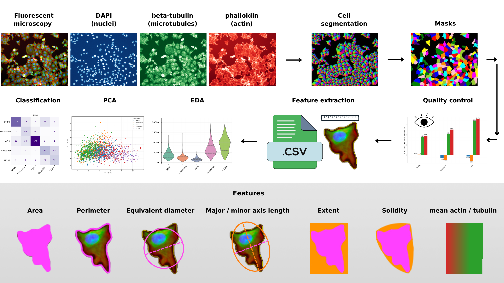

# Cell Segmentation and Morphological Profiling

End-to-end microscopy workflow for segmenting drug-treated MCF-7 breast cancer cells, extracting morphometric features and testing whether cell morphology can distinguish treatment conditions. The project uses the public [BBBC021 dataset](https://bbbc.broadinstitute.org/BBBC021).

[Open the notebook with outputs in Google Colab](https://colab.research.google.com/drive/1EOPU8AgNrdOFhd61035fZIoDfvqkdfvW) · [Read the project report](REPORT.md)



## What this project does

- compares classical watershed, StarDist-guided watershed and Cellpose `cyto3` for whole-cell segmentation;
- preprocessing for three-channel fluorescence microscopy;
- tunes Cellpose parameters (diameter, cell probability threshold, flow threshold, channels)
- extracts 11 interpretable size, shape and intensity features from individual cells;
- applies quality control and retains 3,179 cells for the main analysis;
- evaluates Random Forest classifiers.

## Repository structure

```text
notebooks/
  cell_segmentation_morphological_profiling.ipynb
assets/
  ...
  images.png
  ...
README.md
REPORT.md
Full_report.pdf
Slides.pdf
requirements.txt
```

The notebook is committed without cell outputs. The original executed notebook exceeded GitHub's file limit and can be seen on Google Colab.

[Google Colab](https://colab.research.google.com/drive/1EOPU8AgNrdOFhd61035fZIoDfvqkdfvW) is the recommended environment because Cellpose, StarDist and their dependencies are computationally demanding.

The notebook downloads the selected BBBC021 image plates during execution.

## Tools

Python, Cellpose, StarDist, scikit-image, scikit-learn, PyTorch, TensorFlow, pandas, NumPy, Matplotlib, Seaborn and Plotly.
