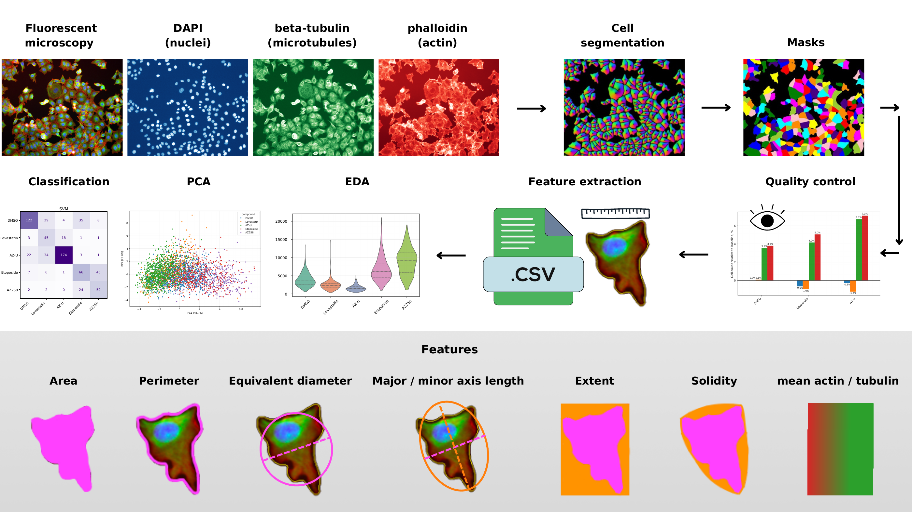
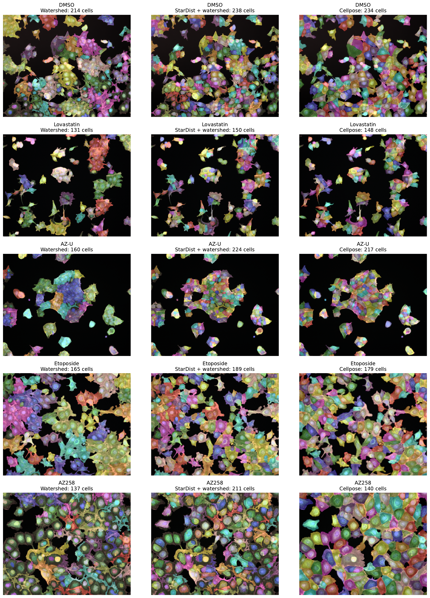
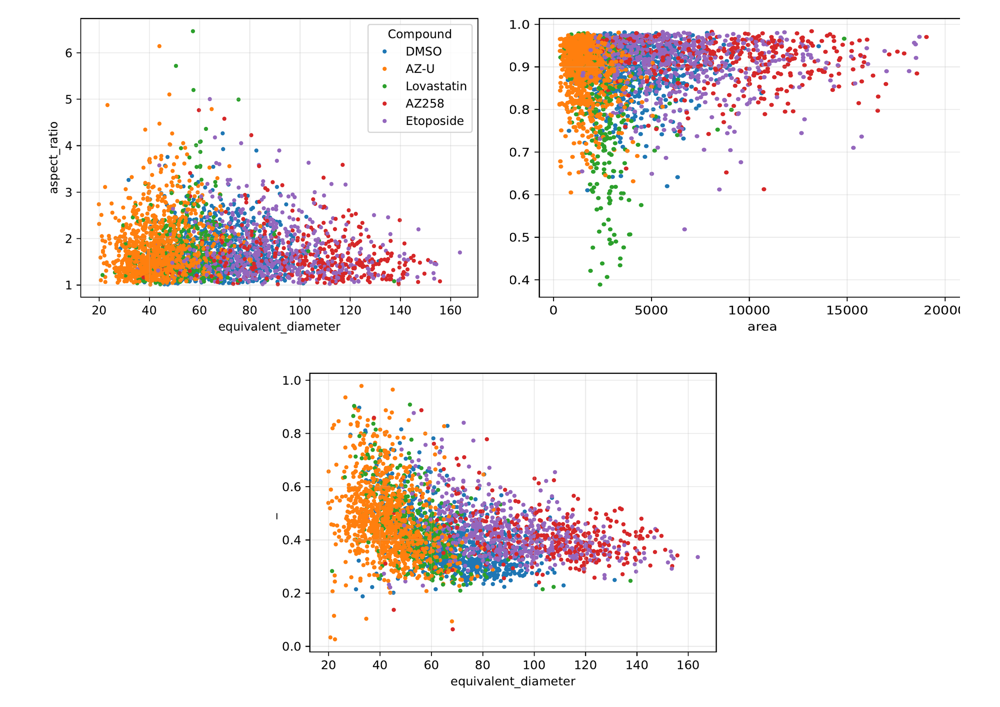
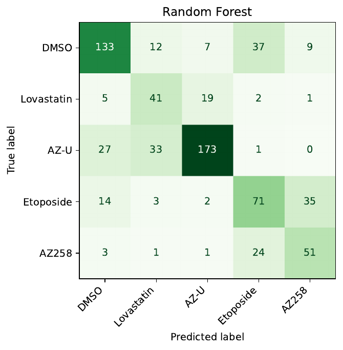

# Cell Segmentation and Morphological Profiling

End-to-end microscopy workflow for segmenting drug-treated MCF-7 breast cancer cells, extracting morphometric features and testing whether cell morphology can distinguish treatment conditions. The project uses the public [BBBC021 dataset](https://bbbc.broadinstitute.org/BBBC021).

[Open the notebook in Google Colab](https://colab.research.google.com/drive/1EOPU8AgNrdOFhd61035fZIoDfvqkdfvW)



## What this project does

- compares classical watershed, StarDist-guided watershed and Cellpose `cyto3` for whole-cell segmentation;
- tunes Cellpose parameters and preprocessing for three-channel fluorescence microscopy;
- extracts 11 interpretable size, shape and intensity features from individual cells;
- applies quality control and retains 3,179 cells for the main analysis;
- evaluates Random Forest classifiers on held-out microscopy fields rather than random cells.

## Results

The main classifier reached **0.67 accuracy** and **0.63 macro F1** on held-out fields. A drug-only experiment, excluding the DMSO control, reached **0.72 accuracy** and **0.67 macro F1** on 507 cells.







The dataset does not include manual whole-cell masks. The segmentation-method comparison is therefore qualitative and based on overlays and count consistency; the reported classification metrics should not be interpreted as segmentation accuracy.

## Repository structure

```text
notebooks/
  cell_segmentation_morphological_profiling.ipynb
assets/
  pipeline.png
  segmentation-comparison.png
  morphometry-pca.png
  random-forest-confusion-matrix.png
requirements.txt
```

The notebook committed here is a source-only portfolio copy with cell outputs cleared. The original executed notebook exceeded GitHub's 100 MB file limit; the key results are preserved above.

## Run the project

Google Colab is the recommended environment because Cellpose, StarDist and their dependencies are computationally demanding. Open the notebook using the link above and run the cells in order. For a local environment:

```bash
python -m venv .venv
source .venv/bin/activate
pip install -r requirements.txt
jupyter notebook notebooks/cell_segmentation_morphological_profiling.ipynb
```

The notebook downloads the selected BBBC021 image plates during execution; the microscopy data are not stored in this repository.

## Tools

Python, Cellpose, StarDist, scikit-image, scikit-learn, PyTorch, TensorFlow, pandas, NumPy, Matplotlib, Seaborn and Plotly.
