# Cellpose-Based Segmentation for Morphological Profiling of Drug-Treated Cancer Cells

**Tamara Besedina · MLDM**

## Introduction

High-content imaging (high-throughput microscopy) is widely used to study how biological samples respond to chemical exposure. For example, some drug compounds may change morphological characteristics in cells by affecting cytoskeleton, DNA replication, or protein regulation. These changes create a measurable phenotypic fingerprint: cells may change their shape, size, nuclear morphology, actin organisation, or microtubule structure depending on the compound's mechanism of action.

However, manual evaluation of microscopy images misses many details required for comparison. Therefore, computational phenotypic profiling is used. It converts microscopy images into numerical features that can capture even subtle cellular changes and enable classification of drug mechanisms of action [Ljosa et al., 2013](https://doi.org/10.1177/1087057113503553).

This project uses an interpretable subset of cells treated with 5 compounds came from the bigger image set of cancer cells fluorescent microscopy [Broad Bioimage Benchmark Collection, BBBC021](https://bbbc.broadinstitute.org/BBBC021).

The aim of the project is to develop a pipeline for cell segmentation, extracting morphometric features, and comparing cellular phenotypes induced by different compounds. This strategy was introduced in previous studies by [Caie et al., 2010](https://doi.org/10.1158/1535-7163.MCT-09-1148) and [Ljosa et al., 2013](https://doi.org/10.1177/1087057113503553).

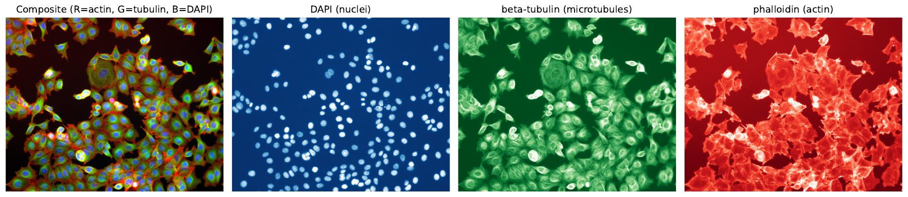

*Dmso reference field Week9 39221 D02*

## Methodological contribution

### Dataset description

The project uses the image set [Broad Bioimage Benchmark Collection, BBBC021](https://bbbc.broadinstitute.org/BBBC021), [Caie et al., 2010](https://doi.org/10.1158/1535-7163.MCT-09-1148), [Ljosa et al., 2012](https://doi.org/10.1038/nmeth.2083) that is microscopy images of MCF-7 breast cancer cells treated for 24 h with a collection of 113 small molecules at eight concentrations. The cells were fixed, labeled for DNA, F-actin, and Beta-tubulin, and imaged by fluorescent microscopy [Caie et al., 2010](https://doi.org/10.1158/1535-7163.MCT-09-1148). Metadata contains linking images to compounds, plates, wells, and concentrations, mechanism-of-action for selected compound-concentration pairs.

**Channels description**

| **Channel** | **Shows** | **Colour** |
| --- | --- | --- |
| DAPI | Nucleus | Blue |
| beta-tubulin | Microtubules | Green |
| Actin | Cytoskeleton | Red |

Each field of view is therefore acquired in 3 channels: the signal from nuclei, microtubules, and actin separately. Each channel is stored as a grayscale TIFF. Several cellular structures are included because a single structure does not describe the entire morphology of a cell. Nuclei help count cells and serve as markers for segmentation. Microtubules provide information about cytoskeletal organisation. The actin cytoskeleton provides information about cell boundaries and cell shape. In other words, DAPI helps show where the cells are, while tubulin and actin help reveal how drug treatment changes cellular structure.

DAPI (4',6-diamidino-2-phenylindole) is a fluorescent DNA-binding dye and is therefore used to visualize cell nuclei. In the image-based profiling assay used for this type of data, the actin cytoskeleton is visualized with fluorescently labeled phalloidin, while the microtubule cytoskeleton is detected using an anti-$β$-tubulin antibody with a fluorescent secondary antibody [Caie et al., 2010](https://doi.org/10.1158/1535-7163.MCT-09-1148). Actin filaments and microtubules are two major components of the cytoskeleton: actin filaments contribute to cell-surface shape, protrusions, movement, attachment to the substratum, and muscle contraction, whereas microtubules support intracellular transport and reorganize into the mitotic spindle during cell division [Alberts et al., 2002](https://www.ncbi.nlm.nih.gov/books/NBK21051/).

The metadata are stored in two CSV files:

- `BBBC021_v1_image.csv` is an index of all images. For each field of view, it contains the filenames of the three channels, the plate, well, site, concentration, and compound name.
- `BBBC021_v1_moa.csv` is a lookup table mapping each compound to its mechanism of action (MOA).

From `BBBC021_v1_image.csv`, we learn that each row represents one field of view. There are 13,200 fields in total. For each field, the table contains information about which three TIFF files correspond to the same location on the plate, which compound the cells were treated with, the concentration, and the well. We use this table to get the image paths and select the required ZIP archives.

In total, the dataset contains 113 compounds x 8 concentrations x 3 replicates.

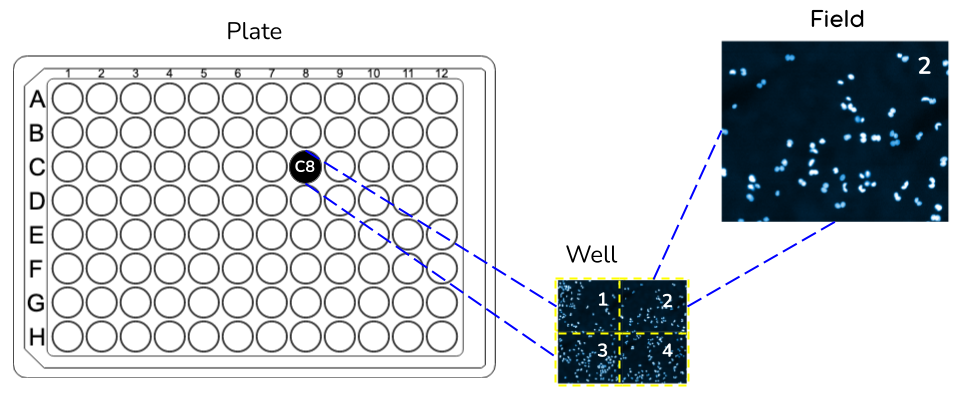

*Plate-well-field hierarchy*

As shown in [Figure](#fig-hierarchy), all images were acquired in 55 96-well plates, which are laboratory plates with wells where cell cultures are grown. One plate corresponds to one ZIP archive of 700 MB. Each plate has 96 wells; each well contains either the control condition (DMSO) or one treatment with one compound at one concentration. A site / field of view is one photographed area within a well, usually 4 sites per well. The three TIFF files are the three channels of the same site.

Each image is a microscopic field of view containing several dozen MCF-7 cells.

### Compound selection

As shown in [Table](#tab-moa), it can be seen that all compounds in the dataset can be divided into 12 mechanisms of action, not counting one DMSO control. There are actin disruptors, Aurora kinase inhibitors, DNA damage mechanisms, etc.

For this study, we would like to choose compounds that are as comparable as possible.

**Mechanisms of action (MoA)**

| Index | moa | compounds |
| --- | --- | --- |
| 0 | DMSO | DMSO |
| 1 | Actin disruptors | cytochalasin B, cytochalasin D, latrunculin B |
| 2 | Aurora kinase inhibitors | AZ-A, AZ258, AZ841 |
| 3 | Cholesterol-lowering | mevinolin/lovastatin, simvastatin |
| 4 | DNA damage | chlorambucil, cisplatin, etoposide, mitomycin C |
| 5 | DNA replication | camptothecin, floxuridine, methotrexate, mitoxantrone |
| 6 | Eg5 inhibitors | AZ-C, AZ138 |
| 7 | Epithelial | AZ-J, AZ-U, PP-2 |
| 8 | Kinase inhibitors | PD-169316, alsterpaullone, bryostatin |
| 9 | Microtubule destabilizers | colchicine, demecolcine, nocodazole, vincristine |
| 10 | Microtubule stabilizers | docetaxel, epothilone B, taxol |
| 11 | Protein degradation | ALLN, MG-132, lactacystin, proteasome inhibitor I |
| 12 | Protein synthesis | anisomycin, cyclohexamide, emetine |

<strong>Way of selection</strong>

Firstly, compounds from different MoA groups should be selected. This way, we will probably obtain the most morphologically distinct cell phenotypes. This is not guaranteed, but it is likely. The aim of the project is not to conduct an exhaustive analysis, but to test whether, in principle, it is possible to distinguish some phenotypes of cells treated with different compounds using machine learning.

Secondly, the compounds have different concentrations, and even different concentration ranges, which also leads us to the assumption that we need to choose compounds with a similar concentration profile.

For example, the selected compounds should have at least three concentrations each, so that we can first choose a middle concentration for comparing the compounds, and then possibly expand the project to analyse all three concentrations in order to understand whether cell morphology differs depending on concentration.

We know that the dataset includes 8 concentrations for each compound. However, the authors did not leave all of them in the metadata table. Most likely, this is because the dataset authors selected the most meaningful concentrations. Therefore, it is more logical to choose from these.

In order not to make the dataset too large while testing the hypothesis, we will choose 4 compounds from different MoA groups among those that have 3 concentrations of a close order of magnitude, plus DMSO as the control.

Notable, we will not compare numerically equal concentrations of different compounds, because this would be incorrect. A concentration of 1.0 for Taxol and 1.0 for Etoposide are not necessarily biologically comparable in terms of effect strength. One compound may already have an effect at the minimum concentration, while another may require a 10 times higher concentration to produce some effect.

Therefore, the compromise chosen for the project ([Table](#tab-compounds)) is that each selected compound will have a low, medium, and high dose within that compound itself.

**Selected compounds, MoA and concentrations**

| MoA group | Compound | Concentrations |
| --- | --- | --- |
| control | DMSO | [0.0] |
| cholesterol-lowering | Lovastatin | [1.5, 5.0, 15.0] |
| epithelial | AZ-U | [1.0, 3.0, 10.0] |
| DNA damage | Etoposide | [1.0, 3.0, 10.0] |
| Aurora kinase inhibitor | AZ258 | [0.1, 0.3, 1.0] |

### Expectations for morphology

<strong>Drugs description</strong>

`DMSO` is a solvent, used as a control to avoid confusing the effect of the solvent with the effect of the drug; it is not expected to do anything and provides normal cells for comparison.

`Lovastatin` can act through the mevalonate pathway, blocking cholesterol synthesis as well as the production of small molecules needed by some proteins to function properly and attach to cell membranes. Therefore, we can expect the cells to contract, become more rounded and sparse, and lose tight contacts with neighboring cells.

`AZ-U`, as an epithelial phenotype agent, makes cells more rounded and compact and promotes closer cell-cell contacts. We expect the cells to be packed more densely into clusters, with clearer boundaries but smaller individual cell size.

`Etoposide` is a DNA-damaging compound that can arrest cells in the phase before division. Expected effects include changes in nuclear morphology, cell-cycle arrest or cell death in part of the population, and a possible decrease in cell density.

`AZ258` is an Aurora kinase inhibitor, disrupting the process of cell division regulated by Aurora kinase; expected effects include disruption of the mitotic spindle, chromosome segregation errors, cell-cycle arrest, apoptosis, cells becoming stuck in mitosis, rounded morphology, and abnormal nuclei.

As shown in the [Figure](#fig-example), DMSO looks like a control condition with mixed morphology: many cells are well spread, cell-cell contacts are present, and there is natural variation in cell shape. Lovastatin appears more sparse; the cells more often form separate groups, with less of a dense continuous layer. The description also fits AZ-U well: dense clusters are visible, and the cells look smaller and tightly packed. For Etoposide, the description does not fully match this example field, which is still quite dense. However, 24 hours may not be enough to induce extensive apoptosis, and the compound may have mainly arrested cell division. Some cells show elongated protrusions and heterogeneous morphology, but these features are not specific enough to conclude failed cell division. They can be interpreted as changes in cell shape and cytoskeletal organization under DNA-damage stress. AZ258 generally matches the expected description: some cells appear to be in the process of division, and double or triple nuclei are visible.

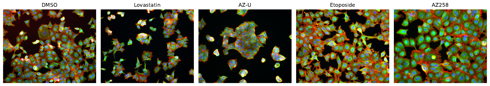

*Example field for each compound*

### Plate selection

Each plate is a separate ZIP file of about 700 MB. Downloading all 55 plates would be about 40 GB, which is not necessary for this analysis. 

<strong>Plate filtering</strong>

We want to download the minimum number of ZIP archives while covering as many of the required compounds as possible ([Table](#tab-plates)).

**Plate coverage for compounds (bold for chosen)**

| Image Plate | compound_norm |
| --- | --- |
| Week10_40111 | [AZ-U, DMSO] |
| **Week10_40115** | **[AZ-U, DMSO]** |
| Week10_40119 | [AZ-U, DMSO] |
| Week3_25461 | [DMSO, Etoposide] |
| Week3_25421 | [DMSO, Etoposide] |
| **Week3_25441** | **[DMSO, Etoposide]** |
| Week4_27801 | [AZ258, DMSO] |
| Week9_39206 | [DMSO, Lovastatin] |
| Week4_27861 | [AZ258, DMSO] |
| **Week9_39221** | **[DMSO, Lovastatin]** |
| Week9_39222 | [DMSO, Lovastatin] |
| **Week4_27821** | **[AZ258, DMSO]** |

Therefore, we need to filter and download plates that contain the largest possible number of compounds selected for analysis at the same time.

In `BBBC021_v1_moa.csv` we cannot find the complete experiment index, but a ground truth table for mechanisms of action. It contains only those compound-concentration pairs that the dataset authors considered meaningful for MOA classification.

Some doses were not included in this MOA subset because they were inactive, overly toxic, or did not pass quality control. Since this project is built around MOA and phenotypic comparison, it is better to take the concentrations from meta data. If we used all concentrations from `BBBC021_v1_image.csv`, we could include doses that may have been unchecked for MOA analysis.

Therefore, we filter the data using the three selected concentrations.

We will also take the middle concentrations of the compounds for the main analysis later. We will compare phenotypes at one middle concentration so that the comparison between compounds is valid. This assumption is based on the idea that the dataset authors estimated the effective concentrations for the compounds in a roughly comparable way.

Nevertheless, we cannot confidently claim that all observed differences are due to the drug effect rather than plate or well effects. Hundreds of cells from the same plate or field of view cannot be treated as fully independent observations.

We will also take DMSO from all plates to check whether the controls from different plates are comparable (no batch or plate effect).

After downloading and extracting the files, we will have 52 fields of view in total: 48 treatment fields of view (4 compounds × 3 concentrations × 4 fields per compound-concentration pair) plus 4 DMSO control fields of view. This gives 52 fields of view × 3 channels = 156 TIFF files.

### Image preprocessing

Each field of view consists of three TIFF files of `uint16` sized 1024x1280. After reading each channel, we:

- convert it to `float32`, to work with continuous rather than integer values and to rescale pixel intensities into a normalized range;
- normalize it to the $[0, 1]$ range by clipping the darkest 1% and brightest 1% of pixels using percentiles. Fluorescence images almost always contain outliers, such as individual extremely bright pixels, artifacts, or especially bright spots within cells. If we do not clip them, standard min-max normalization can make the rest of the image look gray. Therefore, percentile clipping is commonly used;
- build an RGB composite for visualization: red for actin, green for tubulin, and blue for DAPI. We do this after normalizing each channel separately, because if the channels are first combined into an RGB image and then normalized together, one channel may dominate the others due to differences in brightness.

### Watershed baseline

Marker-controlled watershed was used as a classical baseline. DAPI and actin were smoothed; Otsu thresholds produced a nuclei mask and a broader cellular mask; nuclear centers became markers; and watershed partitioned the negative distance transform inside the combined actin+nuclei region. The method is transparent and computationally inexpensive, but its result depends strongly on thresholding and marker placement [Beucher and Lantuejoul, 1979](https://www.researchgate.net/publication/230837383_Use_of_Watersheds_in_Contour_Detection).

The baseline worked for isolated cells but was unreliable in dense fields: missed nuclear markers merged neighboring cells, extra markers split single cells, and fragmented actin signal displaced boundaries. It was therefore retained as a comparison method rather than used for final morphometry.

### StarDist

StarDist represents nuclei as star-convex polygons predicted from the normalized DAPI channel [Schmidt et al., 2018](https://doi.org/10.1007/978-3-030-00934-2_30). In this project, the pretrained `2D_versatile_fluo` model was used both for direct nuclei counting and as a source of markers for watershed over a combined actin+tubulin cellular mask.

The hybrid approach improved marker placement but remained dependent on thresholded cytoskeletal signal for whole-cell boundaries. Its counts were close to Cellpose for most compounds, while AZ258 showed the largest disagreement: StarDist over-segmented small nuclear fragments and missed some large touching nuclei. Without manually annotated whole-cell masks, this comparison is qualitative rather than an accuracy benchmark.

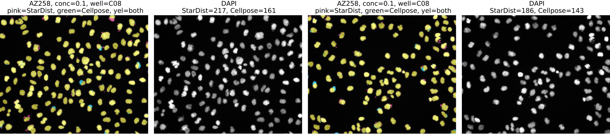

*Nuclei segmentation comparison between StarDist and Cellpose for AZ258*

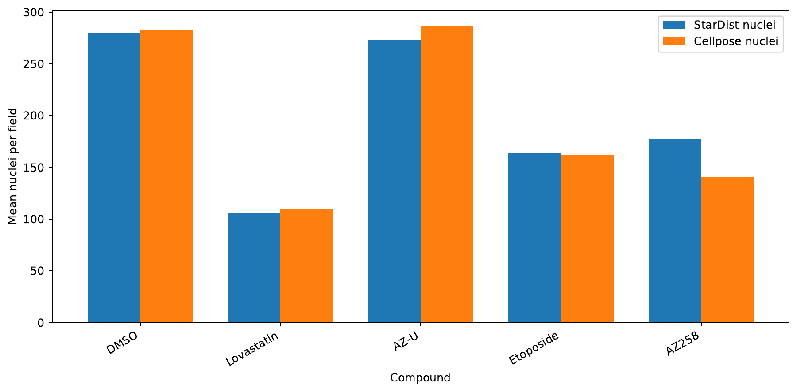

*Nuclei count for StarDist and Cellpose*

### Cellpose

Cellpose is a deep-learning-based segmentation algorithm pre-trained on highly diverse microscopy. Its diverse manually annotated dataset contained more than 70,000 segmented objects [Stringer et al., 2021](https://doi.org/10.1038/s41592-020-01018-x).

The model is based on the U-Net architecture, a widely used neural network for biomedical image analysis. It first compresses the image through downsampling to extract global context and then restores it through upsampling back to the original resolution to define precise object boundaries. The authors added residual blocks and image style representation: skip connections are used between layers of the same size, together with global skip connections from image styles computed at the lowest resolution to all subsequent computational steps.

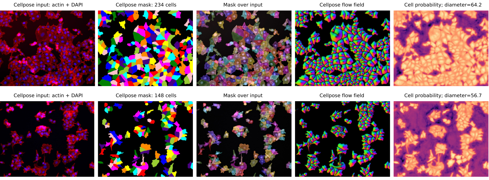

*Cellpose flows and cell probability (DMSO in the first line, Lovastatin in the second line)*

To transform manually annotated masks into a vector flow representation that can be predicted by the neural network, the authors use a simulated diffusion process starting from the centre of the mask. This produces spatial gradients pointing toward the centre of the cell, including indirect paths around corners and complex shapes. The x and y gradients are combined into a single direction from 0° to 360°.

The neural network is trained to predict horizontal and vertical gradients, as well as whether each pixel belongs to a cell. The three predicted maps are combined into a single gradient vector field.

At test time, the predicted gradient vector fields are used to construct a dynamical system with fixed points whose basins of attraction represent the predicted masks. In simple terms, each pixel follows the gradients toward its final fixed point.

All pixels that converge to the same fixed point are assigned to the same mask. This solves the main problem of watershed: touching cells are separated because their centers are different, and the vectors from them point in different directions.

Cellpose is a family of convolutional neural networks. The **`cyto3`** model is a general-purpose version that works across a wide range of cell types without further training. It expects a two-channel image as input. For BBBC021, this is:

- **cytoplasm** -- actin, which shows the overall cell shape;
- **nuclei** -- DAPI.

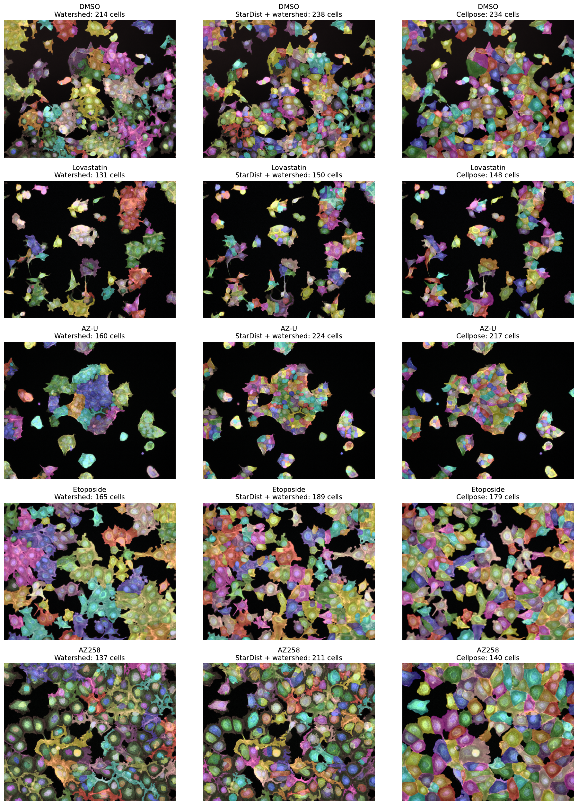

*Comparison of Watershed, StarDist and Cellpose*

<strong>Cellpose hyperparameters</strong>

According to the Cellpose v3.1 documentation, the default parameters are:

- `diameter=None` (auto-estimation)
- `flow_threshold=0.4`
- `cellprob_threshold=0.0`

**Hyperparameters [Cellpose documentation](https://cellpose.readthedocs.io/en/latest/)**

`diameter`, in pixels

Cellpose uses the diameter to rescale the image before segmentation. The v3 cytoplasm models were trained with objects rescaled to a mean diameter of 30 pixels, while the nuclei model was trained with a mean diameter of 17 pixels. Therefore, `diameter` controls the scale at which the network sees the objects.

- `diameter = None` or 0: Cellpose estimates the object size automatically.
- `diameter > 0`: the expected object diameter is specified manually.

Automatic diameter estimation is a two-step procedure. Cellpose first runs the image through the network and obtains a style vector, then uses a linear regression model to estimate object size. The image is resized according to this estimate, Cellpose is run again, and the final diameter is refined from the median diameter of the predicted ROIs. If the specified diameter is too small, Cellpose may over-split cells; if it is too large, neighbouring cells may be merged.

`cellprob_threshold`

Default: `0.0`.

Cellpose predicts three maps: horizontal flows, vertical flows, and cell probability. The cell probability output is a logit. These logits are inputs to a sigmoid centered at zero and typically range approximately from `-6` to `+6`. Pixels with values above `cellprob_threshold` are used in the flow dynamics step to construct ROIs.

- Lower values make the model more permissive and can recover dim or weakly stained cells.
- Higher values make the model stricter and can reduce masks from dim regions or background texture.
- Too low a value may include debris or weak artefacts; too high a value may remove real but low-contrast cells.

`flow_threshold`

Default: `0.4`.

This parameter is a mask-quality filter. After Cellpose predicts flows and constructs candidate masks, it recomputes flow gradients from the recovered masks and compares them with the flows predicted by the neural network. The comparison is based on mean squared error. The `flow_threshold` parameter is the maximum allowed flow error for a mask to be kept.

- Lower values are stricter: more masks with inconsistent or distorted flows are discarded.
- Higher values are more permissive: more ROIs are retained, but some may have poor or biologically implausible shapes.
- Increasing `flow_threshold` can help if Cellpose returns fewer ROIs than expected; decreasing it can help if too many ill-shaped ROIs are accepted.

### Grid search with set diameter

To optimize the Cellpose configuration, a grid search ([Figure](#fig-cellpose-grid-search), [Figure](#fig-grid-diameter-overlays)) was performed around the default settings. The baseline configuration used automatic diameter estimation, `cellprob_threshold=0.0`, and `flow_threshold=0.4`. For the grid search, `diameter` was tested as `None`, 50, 70, and 90 pixels. These values were chosen because a preliminary Cellpose run with automatic diameter estimation returned average cell diameters between approximately 43 and 96 pixels for different compounds, so the tested manual diameters covered this observed scale range. The `flow_threshold` values 0.2, 0.6, and 1.0 were selected to test settings below and above the default value of 0.4. The `cellprob_threshold` values -1.0, -0.5, and 1.0 were selected to cover a range around the default value of 0.0, from more permissive to stricter foreground acceptance. Each parameter combination was applied to the same selected fields, and the resulting masks were compared by object counts and visual overlay inspection.

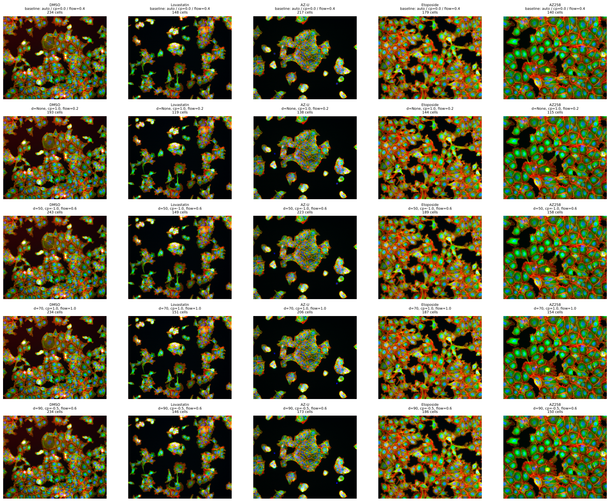

*Сellpose grid search overlays for diameters*

On [Figure](#fig-cellpose-grid-search), the diagram shows the change in the number of detected objects relative to the model with default parameters. A high bar does not always mean better performance: it can reflect either true recovery of missed cells or over-segmentation.

The main conclusion is that `flow=0.2` should be excluded. In all panels and for all compounds, the bars for `flow=0.2` go strongly downward. At the same time, visual inspection of the masks shows that whole cell regions and clusters disappear. This looks like overly strict mask filtering by flow quality: complex, dim, merged, or poorly separable cells receive unstable flows and are excluded.

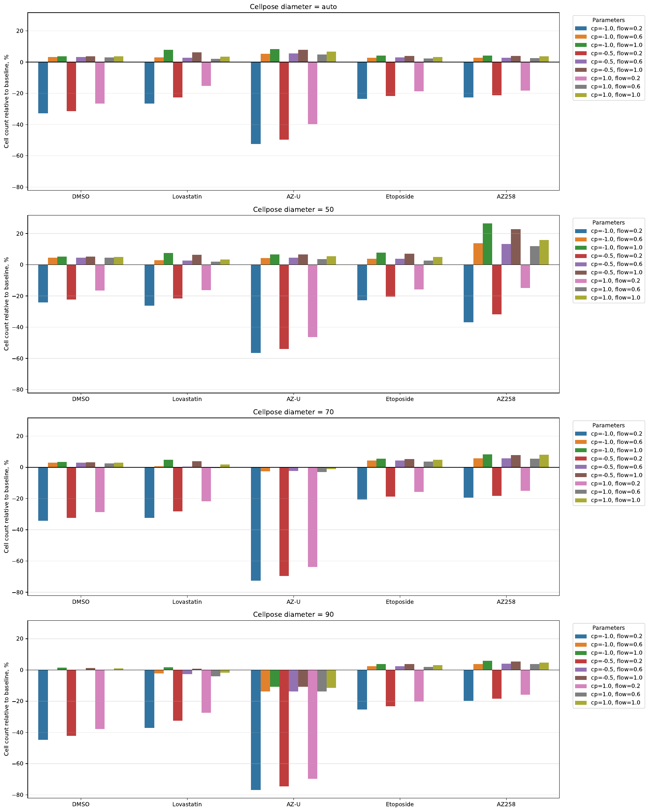

*Cell count during Cellpose grid search*

**Effect of diameter**

Different compounds respond to `diameter` differently because the real cell sizes are very different.

<strong>Drugs and diameters</strong>

**AZ-U** cells are the smallest ones (`Cellpose mean diameter = 43.0`). They are gathered into compact clusters, have blurred boundaries and merged nuclei, sometimes with 3--5 nuclei in one clump, making it difficult to determine where one cell ends and another begins. They are difficult to segment. Therefore, with `d=50`, segmentation is generally acceptable, but some small isolated cells are lost. With `d=70`, and especially with `d=90`, the model starts merging several cells into one and loses cells.

**Lovastatin** cells are slightly larger (`Cellpose mean diameter = 56.7`), but very heterogeneous: some are merged with unclear nuclei and boundaries, while others are large and have long protrusions. They form clusters, but fewer than AZ-U and the other compounds; they are more sparse, but not isolated. This makes them difficult to segment. Therefore, with `d=50`, they are generally segmented reasonably well, but small cells are lost because the fixed diameter is too large for them. With `d=70` and above, clear under-segmentation appears.

**DMSO** cells are medium-sized (`Cellpose mean diameter = 64.2`). They are heterogeneous, with both smaller and larger cells, and they are quite densely packed. However, nuclei and boundaries are not always clear, and there are no large protrusions. This makes segmentation moderately difficult. For this reason, the effect of diameter is relatively weak for DMSO.

**Etoposide** cells are larger mainly because of protrusions (`Cellpose mean diameter = 80.7`). They lie close to each other, but their boundaries are blurred. They have protrusions that the model identifies as separate cells, and none of the tested Cellpose parameters can fully solve this. However, the nuclei are clear, so the overall segmentation difficulty is moderate. They are segmented well with `d=70/90`, while with `d=50` the cells are slightly fragmented.

**AZ258** cells are the largest in the dataset (`Cellpose mean diameter = 96.3`). They mostly lie close to each other, have fairly clear contours and large nuclei, and are relatively convenient for segmentation. For them, `d=50/70` are clearly too small and increase the number of segmented cells by cutting large cells into pieces or by narrowing mask boundaries so that they do not reach the real cell borders. At the same time, even `d=90` is not ideal, because a large dim cell is clearly under-segmented or split in half. This shows that with a fixed diameter, information about very large but real cells is lost.

Therefore, a fixed diameter for all compounds is not suitable here. `d=50` does not strongly harm small or medium cells, but does not allow normal segmentation of AZ258 and Etoposide. `d=70/90` do not strongly harm large AZ258 and Etoposide cells, but cause under-segmentation of Lovastatin and AZ-U. The most stable option for the whole dataset is `diameter=None`, i.e. auto-estimation.

**Other parameters**

`cellprob_threshold` is a fine sensitivity adjustment. In practice, as we see from the masks, it affects the margin around the segmented object. With `cp=-0.5` and `cp=-1.0`, more background is captured, while with `cp=0` and `cp=1`, the mask boundary fits the cell more tightly. This is because this parameter is the probability/confidence threshold used by Cellpose to decide which pixels are considered cellular and included in the mask.

Based on visual inspection of the masks, with `cp=-0.5` or `cp=-1.0`, the threshold is lower, so Cellpose includes more weak or boundary pixels. Therefore, the masks often become larger and dim cells may appear, but the risk of capturing background, cytoplasmic fragments, and imaging artefacts also increases. For our task, negative values are better avoided: for Lovastatin, they lead to over-segmentation of artefacts and cell parts that clearly should not have been included in the masks, with pieces of cytoplasm segmented as separate small cells. For Etoposide, they make the mask boundaries too large for the cells. Whether to use `cp=0` or positive values will be clarified in the next grid search.

The difference between `flow_threshold=0.6` and `flow_threshold=1.0` is moderate, but `flow_threshold=1.0` more often keeps poor-quality masks. For morphometry, this is riskier than a small undercount.

In principle, it would be safe either to keep the baseline or to slightly adjust the flow to `flow_threshold=0.6`, because for two compounds, the default settings lose 1--2 cell parts: Etoposide and AZ-U. For the other compounds, the baseline is fine.

For fine-tuning, we will perform a second grid search.

### Grid search (automatic diameter)

The second grid search ([Figure](#fig-cellpose-grid-search-auto), [Figure](#fig-grid-auto-overlays)) was designed as a refinement of the first one. The first grid showed that manually fixing `diameter` is not a robust strategy for this dataset: the apparent cell diameter varies strongly between compounds, because different treatments affect cell size and morphology in different ways. Since the final pipeline should work across compounds with different phenotypic effects, a single manually selected diameter would either over-split larger cells or merge smaller neighbouring cells. Therefore, in the second grid search, `diameter` was kept automatic for all variants, and the search focused on `cellprob_threshold` and `flow_threshold`. The value `flow_threshold=0.2` was also removed, because in the first grid search it performed poorly and caused entire clusters of cells to be lost. The second grid tested `flow_threshold` values 0.4, 0.6, 0.8, and 1.0, covering the default setting and more permissive mask-quality filtering. The `cellprob_threshold` range was expanded to -2.0, -1.0, 0.0, 1.0, and 2.0, because the first grid did not clearly identify which threshold was best. As before, all variants were evaluated on the same selected fields using object counts and visual overlay inspection.

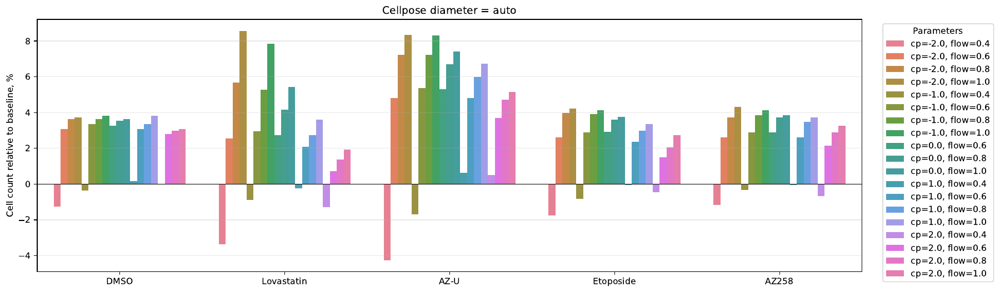

*Cell count during Cellpose grid search with automatic diameter*

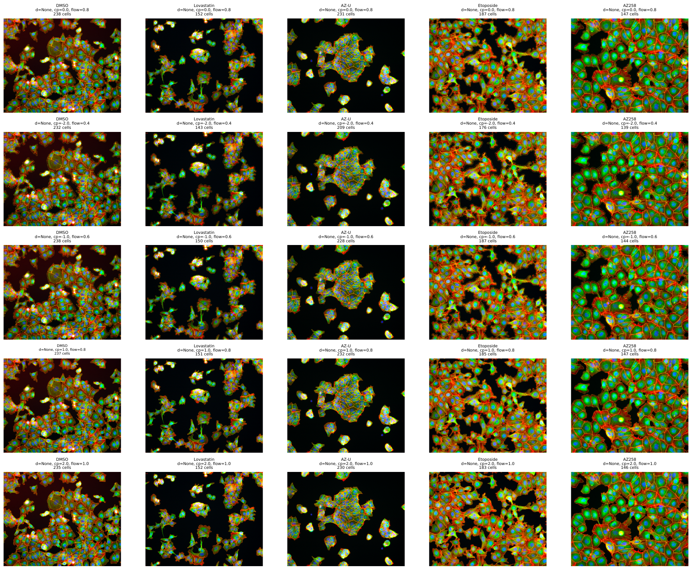

*Cellpose grid search overlays with auto diameter*

On [Figure](#fig-cellpose-grid-search-auto), we see more subtle and sometimes even insignificant changes in the masks caused by parameter changes. Most bars lie within 4% relative to the baseline, while the others are up to approximately 8%. Therefore, here we are testing the sensitivity of the model to `cellprob_threshold` and `flow_threshold`.

The main conclusion is that `diameter=None` works robustly for all compounds, and further parameter tuning gives relatively small changes in cell count.

<strong>Drugs and parameters</strong>

For DMSO, `cp` and `flow` almost do not change the result. Visually ([Figure](#fig-grid-auto-overlays)), there are no sharp changes in segmentation. Slight over-segmentation starts only at the very end, at `cp=2.0, flow=1.0`. At `cp=-2.0`, it is visible that the margins of the masks from the real cell boundaries become larger, but overall the segmentation remains acceptable.

For AZ258, the absence of a strong effect is even more pronounced: in general, all parameters are acceptable, because the cells are large, clear, high-contrast, and do not have many protrusions. This is interesting that even the mask boundaries and cell boundaries generally match well, because most cells are densely packed.

For Lovastatin, `cp=-2.0, flow=0.4` is definitely unsuitable because cells are lost. After that, segmentation is normal when changing parameters up to `cp<1.0`. With `cp>=1.0`, the masks become tighter and tighter and eventually start cutting off cell protrusions. This is probably problematic here because some cells have long protrusions. `flow` does not play a major role, except that it compensates for the effect of `cp=-2.0`, and at `flow>=0.6` cells are no longer lost.

AZ-U is a difficult case. The baseline with default parameters is definitely unsuitable for it, as are some negative `cp` values and even `cp=1.0, flow=0.4`, because of under-segmentation. At `cp>=2.0`, part of the cells is already cut off and very small cells are created from cytoplasm. Therefore, the working zone for AZ-U lies at the intersection of `flow=0.6/0.8` and `cp=-2.0/-1.0/0.0/1.0`, although there is still slight under-segmentation and slight over-segmentation of small cell fragments.

For Etoposide, the default parameters are also unsuitable because cells are lost. However, the other parameters are acceptable, although negative `cp` values expand the mask boundaries compared with the cell boundaries. The most optimal choice is at the intersection of `flow=0.6/0.8` and `cp=0.0--2`.

Increasing it to `flow=0.6` or `flow=0.8` often gives the best balance: it recovers some objects, but does not yet preserve too many extra masks. `flow=1.0` gives the maximum number of cells, but the masks show that part of this increase may be over-segmentation.

For `cellprob_threshold`: its negative values often lose cells at `flow=0.4`, while at higher `flow` they produce masks that are too wide. Conversely, `cp=2.0` makes the masks too narrow and cuts off parts of cells. Therefore, conservatively, we will keep `cp=0.0`, but increase the flow threshold to `0.8`. This should help Etoposide and AZ-U, where the baseline loses individual cells or parts of cells, but should not strongly worsen segmentation for the other compounds.

### Improving Cellpose segmentation

In addition to tuning hyperparameters, such as the expected cell diameter, the confidence threshold `cellprob_threshold`, and `flow_threshold`, we can also try to further improve the segmentation. The segmentation is already good, but not perfect, especially for AZ-U, where under- and oversegmentation remain at any parameter settings. Compared with Watershed, this is not a serious problem, but we will still try to improve the segmentation. We will try to make the input data more complete and higher-contrast using:

1. **Merging actin and tubulin into one cytoplasmic channel** using `np.maximum` ([Figure](#fig-merged-actin-tubulin)). Both proteins are located in the cytoplasm; when one of them is depolymerized, the other can partially compensate for the signal. Logically, this works like an "OR" operation between the two signals. We merge these channels both without CLAHE and after CLAHE, to compare whether there is a combined effect.
2. **CLAHE (Contrast-Limited Adaptive Histogram Equalization)** -- local contrast enhancement ([Figure](#fig-clahe-actin)). This method divides the image into small regions and normalizes the contrast separately within each region, while limiting the amplification so that noise does not increase too much. This is a standard method in medical imaging, including ultrasound, X-ray images, and histology.

Both methods, together with the tuned hyperparameters, can complement each other.

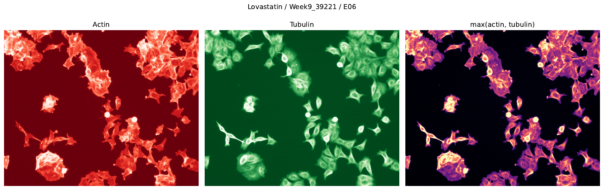

*Merged actin and tubulin channel*

For CLAHE, we will use `equalize_adapthist`. It has two parameters:

- `kernel_size=128` -- the size of the local window. The smaller the window, the more aggressive the local normalization. We choose a default parameter equal to 1/8 of 1024, which fits the size of our images.
- `clip_limit=0.01` -- limits the maximum contrast amplification within each local region. Values are normalized between 0 and 1; higher values give more contrast.

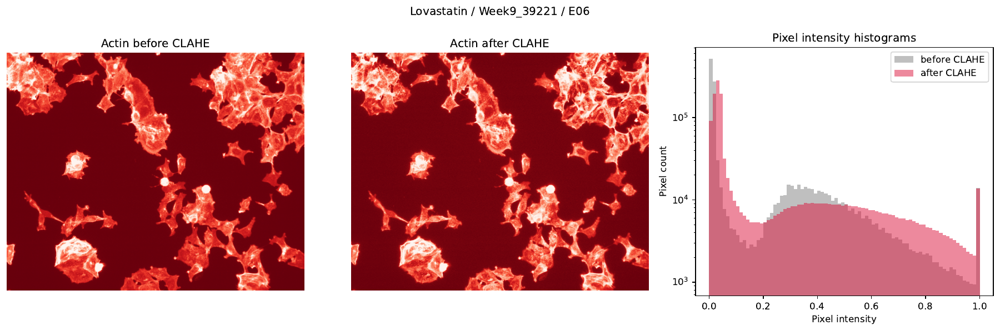

*Actin channel before and after CLAHE*

We applied CLAHE and channel merging separately, compared them with the tuned model, and also tested a combined approach in which all three strategies were used together with the hyperparameter-tuned model ([Figures](#fig-cellpose-enhanced-modes-cell-count) and [here](#fig-cellpose-clahe-and-others)).

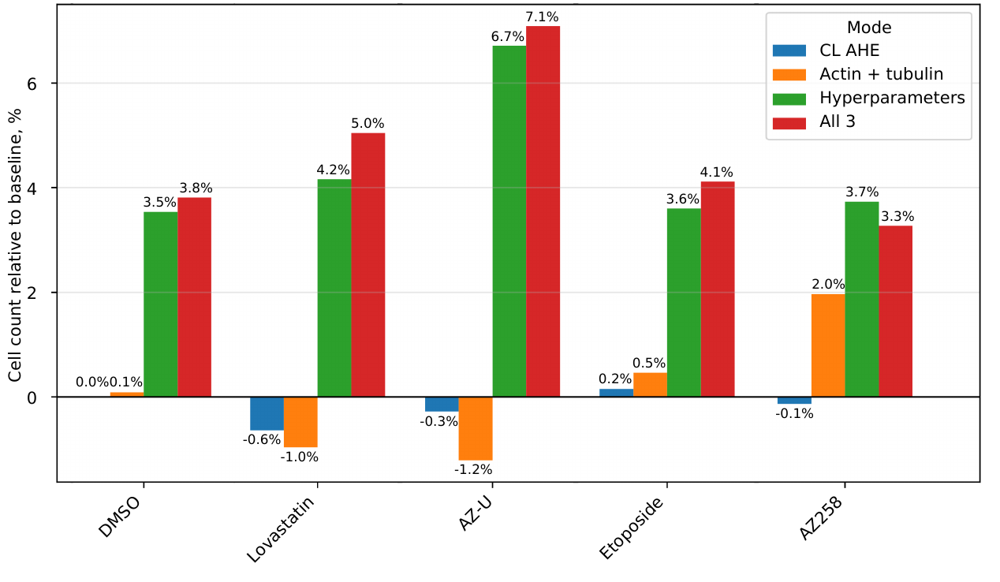

*Cellpose enhanced modes cell count*

As a result, applying all three methods together led to oversegmentation. The model started to identify structures as separate cells that were not segmented as separate objects when the methods were applied individually. These were mostly cytoplasmic fragments. Segmentation was especially poor for Etoposide: the masks split cells into several parts while also undersegmenting large, clearly visible cytoplasmic regions. However, when used separately, none of the methods produced poor segmentation for Etoposide; the problem appeared only when they were combined. AZ258 was also affected by this synergy: the masks became much smaller than the actual cell boundaries. Most likely, this happened because the simultaneous contrast enhancement from CLAHE and the merging of tubulin with actin created too many high-contrast boundaries within a single cell. Cellpose then started to interpret these internal structures as boundaries between separate cells.

It is also interesting that the channel merging completely failed for Lovastatin. At least five cells that were clearly visible by eye were not segmented in the field of view. For the other compounds, the changes were not substantial based on visual inspection.

CLAHE alone was also not very poor, but it was not fully reliable. It slightly improved segmentation for DMSO and AZ258, but for Lovastatin and AZ-U it missed cells.

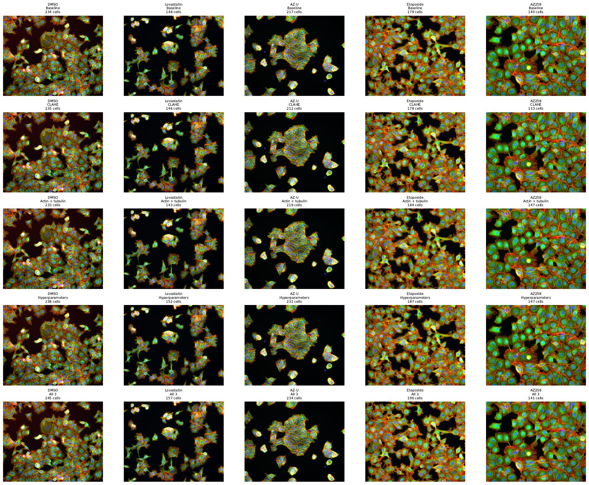

*Comparison of Cellpose with CLAHE, merged channels and tuned parameters*

### Segmentation quality control

After three grid searches for Cellpose parameter tuning and input improvement, we obtained a model that was used to generate cell masks for all five compounds at the middle concentration. Now it is important to check whether our expectations were met:

- whether the plates are similar in the number of segmented cells;
- whether there are outliers and what they are related to;
- whether DMSO from different plates looks similar;
- whether the cell counts agree with the overlay masks.

In [Table](#tab-summary), we see the mean number of segmented cells per field and the corresponding standard deviation. AZ258 is the most consistent condition: the difference between fields is about 10 cells. Etoposide varies slightly more, while DMSO and Lovastatin are of a similar order. AZ-U is concerning because its standard deviation is large, approximately half of its mean cell count.

**Summary statistics of cell counts**

| Compound | n fields | mean cells | std cells | total cells |
| --- | --- | --- | --- | --- |
| AZ-U | 4 | 297.2 | 104.4 | 1189 |
| AZ258 | 4 | 134.8 | 10.3 | 539 |
| DMSO | 4 | 285.2 | 44.4 | 1141 |
| Etoposide | 4 | 179.5 | 19.6 | 718 |
| Lovastatin | 4 | 103.5 | 41.4 | 414 |

We check this in [Figure](#tab-boxplot). AZ-U has a strong outlier, which explains its large standard deviation. However, the other three AZ-U fields are close to each other, which keeps the median more stable. We will not remove this outlier. Instead, we check the original image to see whether this field really contains so many cells or whether this is a segmentation error. As shown in [Figure](#fig-outliers-az-u), the mask overlay confirms that there are indeed many cells in this field, approximately twice as many as usual. Several cell clusters are located very close to each other. This is not a segmentation error, but a specific property of this image. Similar information can be obtained from the Lovastatin mask overlays: its outlier is also explained by a denser cell field.

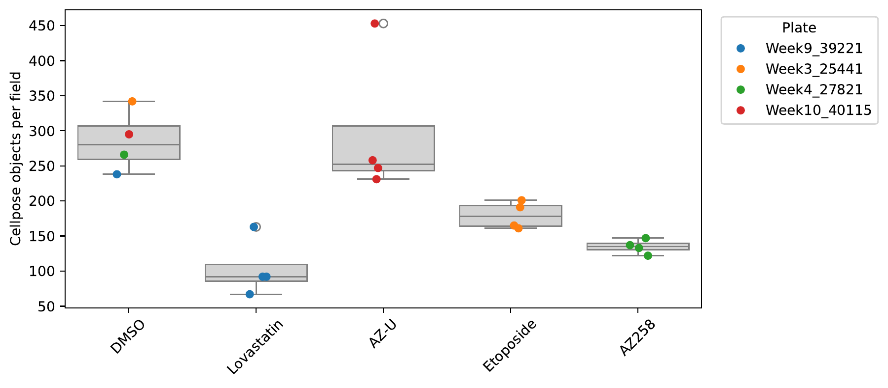

*Cell counts per field by compound and plate*

[Figure](#tab-boxplot) also shows that DMSO fields from different plates are close in cell count, with approximately 250--300 objects per field and a median around 280. This is a high and relatively stable control. It suggests that the plates can be compared with each other, because their controls are similar.

Regarding the similarity between plates, we clearly see clusters by compound. Etoposide and AZ258 are especially compact, and they also have the lowest number of objects. This could be an important sign of drug effect if the effect is truly biological. It could be explained by reduced cell survival under drug treatment. However, this requires consultation with a biologist and validation on a larger sample. Our small dataset does not allow us to make such strong conclusions. We can only state that, in this work, the number of cells is visually consistent with the Cellpose mask overlays.

### Morphometry collection

We confirmed that the segmentation can be considered valid. We can now extract data from the masks. The `skimage.measure.regionprops` method computes dozens of geometric and intensity-based characteristics for each cell in the mask. [Table](#tab-morphometry) lists the 11 most interpretable features that we will use in this work.

**Morphometry features**

| Feature | Meaning |
| --- | --- |
| `area` | Cell area in pixels |
| `perimeter` | Length of the cell boundary |
| `eccentricity` | How elongated the cell is: 0 to a circle, and 1 to a thread-like shape |
| `solidity` | `cell area / area of its convex contour`; how complex the contour is |
| `extent` | `cell area / area of the bounding box` |
| `equivalent_diameter` | Diameter of a circle with the same area |
| `major_axis_length` | Length of major axis of ellipse fitted |
| `minor_axis_length` | Length of minor axis of ellipse fitted |
| `aspect_ratio` | `major_axis_length / minor_axis_length`; a measure of elongation |
| `mean_actin` | Average brightness of the actin channel |
| `mean_tubulin` | Average brightness of the tubulin channel |

Before working with these features, however, incomplete cells must be removed so that they do not distort the data. Labeled objects that touch the image border are removed using the `clear_border` method from skimage.

Next, we filter out artefacts: objects that are either too small or too large. Small objects may correspond to cell fragments or imaging artefacts, while large objects may represent merged cells that were segmented incorrectly. To avoid removing biologically relevant cells, we estimate the threshold values from the expected diameters returned by Cellpose, which correspond to areas from 1,452 px to 7,284 px ($A ≈ π (d/2)^2$).

**Area distribution quantiles**

| Index | **0.01** | **0.05** | **0.50** | **0.95** | **0.99** |
| --- | --- | --- | --- | --- | --- |
| DMSO | 2.09 | 1328.65 | 3539.0 | 7011.10 | 8663.34 |
| Lovastatin | 429.15 | 923.90 | 2280.5 | 4130.85 | 6342.13 |
| AZ-U | 295.85 | 588.00 | 1452.0 | 3238.30 | 4059.16 |
| Etoposide | 1.00 | 2218.85 | 6009.5 | 12773.75 | 17691.27 |
| AZ258 | 1.00 | 2331.40 | 9057.0 | 15312.85 | 17638.24 |

We also use the area distribution by quantiles as a reference point ([Table](#tab-area-quantiles)). We can see that for three compounds the area goes down to 1--2 pixels or less, while the largest objects reach 17,000 pixels or more.

We choose wider conservative limits: objects with `area < 300` px and objects with `area > 25000` px are removed. This keeps the tails of the distributions in the violin plots while excluding obvious artefacts.

## Results

### Exploratory data analysis

We now have a cell-features table. This allows us to address the main question of the project: **how cell morphology differs under different drug treatments.**

To do this, we build violin plots for the selected features, apply PCA dimensionality reduction to test whether the treatments are separable by class, build pairplots to check whether the treatments separate by combinations of features, and summarize the z-normalized mean feature values by compound in a heatmap.

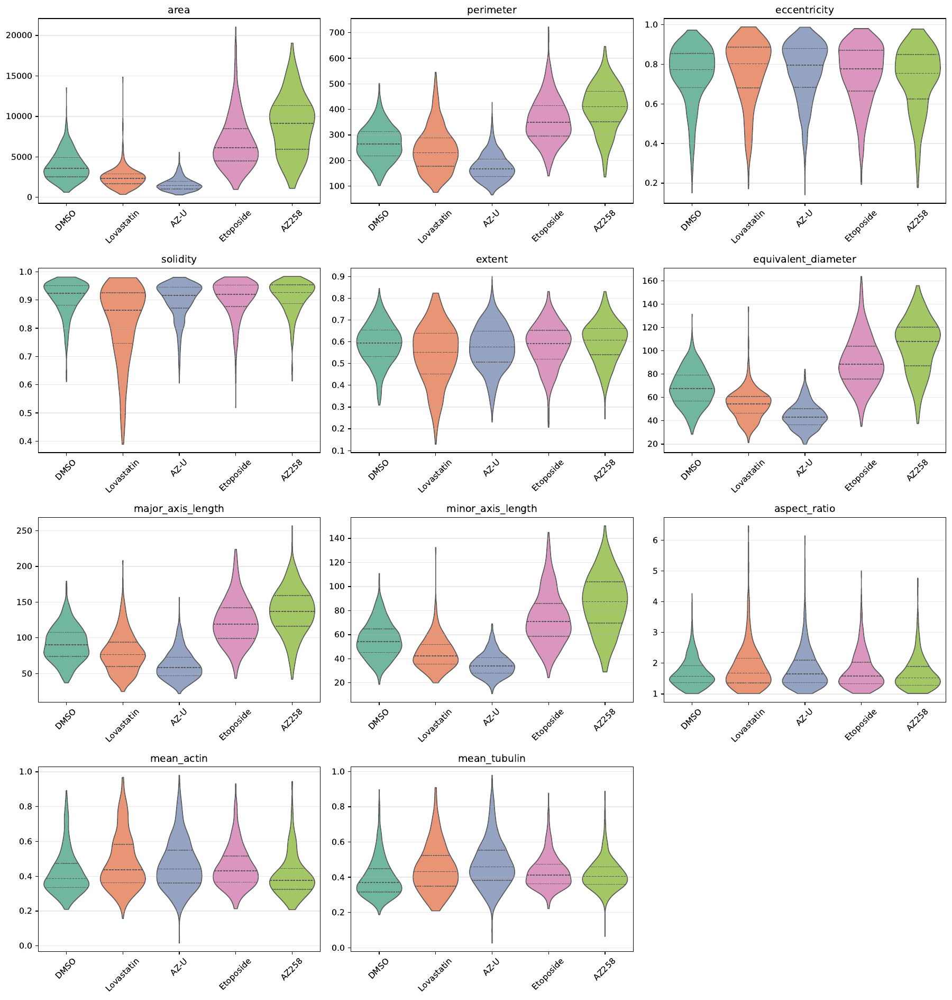

*Morphometry violins*

The feature violin plots in [Figure](#fig-violins) show that there are differences between the treatments. The main separation is observed in size-related features: `area`, `perimeter`, `equivalent_diameter`, `major_axis_length`, and `minor_axis_length`, which are expected to be strongly correlated. AZ-U shows the smallest phenotype, Lovastatin is closest to it, whereas AZ258 and Etoposide have the largest cells, with DMSO lying in between.

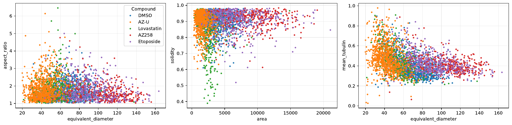

*Morphometry PCA informative pairs*

The separation by shape is weaker. `eccentricity` and `aspect_ratio` strongly overlap between compounds, meaning that elongation alone does not separate the classes well. `solidity` is more informative: Lovastatin has a noticeably wider lower tail, which may indicate more irregular or complex masks, or differences in cell shape that is actually true and seen on the images.

The intensity features, `mean_actin` and `mean_tubulin`, also show shifts between groups, but these differences are less clean than those observed for size-related features. `mean_tubulin` appears more useful than `mean_actin`, although the overlap remains substantial.

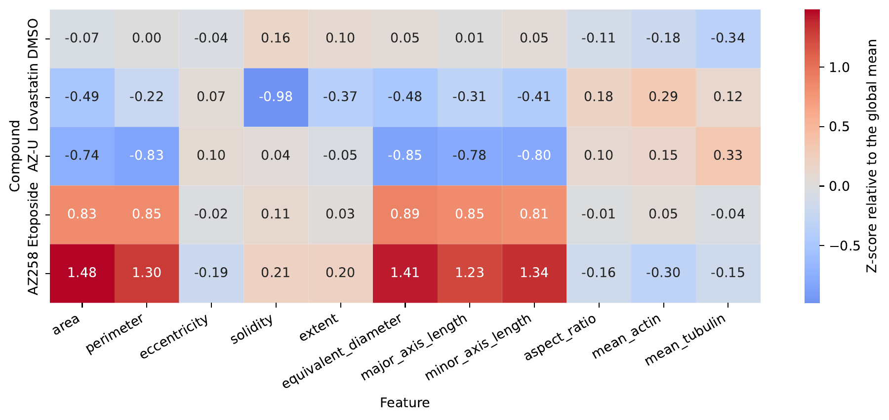

*Morphometry heatmap*

The z-heatmap in [Figure](#fig-zheatmap) confirms what is visible in the violin plots. Here, size-related features also separate the groups most strongly. AZ258 is sharply above average in `area`, `perimeter`, `equivalent_diameter`, `major_axis_length`, and `minor_axis_length`; Etoposide is also above average, but less strongly. AZ-U, in contrast, is below average for almost all size features. DMSO is close to zero.

Lovastatin is interesting not so much in terms of size, but in terms of shape: it has strongly negative `solidity` (-0.98) and reduced `extent`. This is consistent with its more irregular, less compact cells with complex shapes.

There is no separation in `eccentricity` and `aspect_ratio`: the values are close to zero. This means that elongation is not the main driver of the differences.

In terms of intensity, DMSO and AZ-U are higher in `mean_tubulin`, Lovastatin is slightly higher in `mean_actin`, and AZ258 is lower in `mean_actin`.

Interestingly, PCA in [Figure](#fig-pc1-pc2) shows strong overlap between the groups, whereas the pairplots in [Figure](#fig-pairs) separate the data visually more clearly than the PC1/PC2 projection. The feature pairs show that some classes differ in cell size, shape, and tubulin intensity, although the overlap is still substantial. PCA is likely less suitable for this specific comparison because it is not designed to separate classes; it only finds the axes of maximum variance, rather than the best boundaries between compounds.

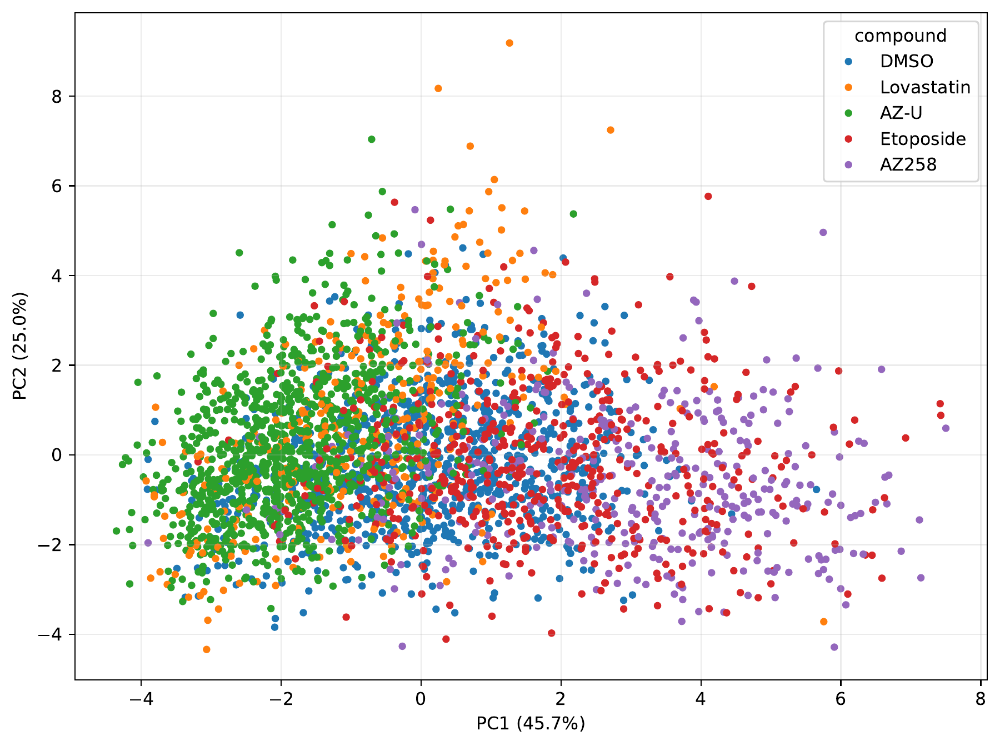

*PC1/PC2*

### Classifiers

We build simple classifiers using the extracted features to test whether the classes of compounds used to treat the cells can be distinguished based on morphology.

First, it is important to split the data into training and test sets to avoid data leakage. We split the data by `field_id`, stratified by `compound`. This means that cells from the same field of view cannot appear in both the training and test sets at the same time. We have 4 fields of view per compound, so for each compound, 3 fields are used for training and 1 field is used for testing. If more data were available, we could also stratify by well, since wells may not be fully independent.

**Train-test split by field**

| Index | compound | train_fields | test_fields | train_cells | test_cells |
| --- | --- | --- | --- | --- | --- |
| 0 | DMSO | 3 | 1 | 701 | 198 |
| 1 | Lovastatin | 3 | 1 | 269 | 68 |
| 2 | AZ-U | 3 | 1 | 812 | 234 |
| 3 | Etoposide | 3 | 1 | 404 | 125 |
| 4 | AZ258 | 3 | 1 | 288 | 80 |

We train four classifiers: Logistic Regression as a simple linear baseline model, Random Forest as a nonlinear baseline model, SVM as a nonlinear margin-based classifier, and Decision Tree as an interpretable model.

Separately, we also train drug-only models without `DMSO`: an SVM and a Random Forest. This allows us to test how well the models distinguish only active treatments without the control class.

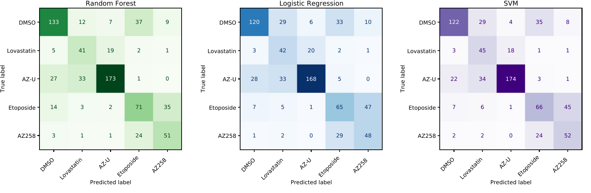

*Confusion matrices*

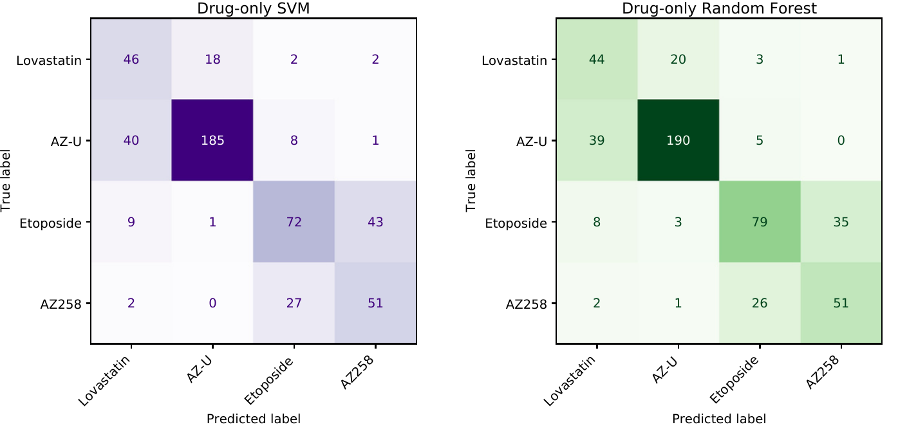

*Drug-only confusion matrices*

Across all classifiers, the confusion matrices ([Figure](#fig-conf-matrix), [Figure](#fig-drug-conf-matrix)) show that the models are not guessing the classes randomly: most values lie on the diagonal, meaning that many cells are classified correctly. `AZ-U` is separated best.

The main problem is that not all compounds have a unique morphometric profile based on these 11 features. `DMSO` is often confused with `Etoposide` and `Lovastatin`; `Lovastatin` is noticeably confused with `AZ-U`; and the strongest pair of errors is `Etoposide` versus `AZ258`.

This pattern is repeated across all classifiers, which suggests that the limitation is more likely related to the data or the feature set rather than to the models themselves. The morphometric features provide a useful signal, but it is not sufficient to fully separate all treatment phenotypes at the single-cell level.

In the drug-only models without `DMSO`, the models still separate `AZ-U` well. `Etoposide` and `AZ258` remain a closely related pair. The main new observation is that `Lovastatin` is strongly confused with `AZ-U`. Thus, removing the control class does not solve the problem of similar morphometric profiles among active treatments; instead, it makes this problem more visible.

The model performance metrics in [Table](#tab-accuracy) and [Table](#tab-f1-scores) confirm that the classes overlap, although a useful signal is still present. Random Forest performed best. Macro F1 is lower than weighted F1 for almost all models. This means that the models recognise some individual classes less well, while the overall accuracy is largely supported by the easier and more numerous classes, AZ-U and DMSO. The F1-scores show that Etoposide and AZ258 are weakly separated, while Lovastatin is the weakest class overall.

**Overall classifier performance**

| Model | Accuracy | Macro avg F1 | Weighted avg F1 |
| --- | --- | --- | --- |
| Drug-only RF | 0.72 | 0.67 | 0.72 |
| Drug-only SVM | 0.70 | 0.65 | 0.71 |
| Random Forest | 0.67 | 0.63 | 0.67 |
| SVM | 0.65 | 0.61 | 0.66 |
| Log Reg | 0.63 | 0.59 | 0.64 |

**F1-scores**

| Model | DMSO | Lovastatin | AZ-U | Etoposide | AZ258 |
| --- | --- | --- | --- | --- | --- |
| Drug-only RF | -- | 0.55 | 0.85 | 0.66 | 0.61 |
| Drug-only SVM | -- | 0.56 | 0.84 | 0.62 | 0.58 |
| Random Forest | 0.70 | 0.52 | 0.79 | 0.55 | 0.58 |
| SVM | 0.69 | 0.49 | 0.81 | 0.52 | 0.56 |
| Log Reg | 0.67 | 0.47 | 0.78 | 0.50 | 0.52 |

**Precision and recall**

| Model | DMSO P | DMSO R | Lov. P | Lov. R | AZ-U P | AZ-U R | Eto. P | Eto. R | AZ258 P | AZ258 R |
| --- | --- | --- | --- | --- | --- | --- | --- | --- | --- | --- |
| Drug-only RF | -- | -- | 0.47 | 0.65 | 0.89 | 0.81 | 0.70 | 0.63 | 0.59 | 0.64 |
| Drug-only SVM | -- | -- | 0.47 | 0.68 | 0.91 | 0.79 | 0.66 | 0.58 | 0.53 | 0.64 |
| Random Forest | 0.73 | 0.67 | 0.46 | 0.60 | 0.86 | 0.74 | 0.53 | 0.57 | 0.53 | 0.64 |
| SVM | 0.78 | 0.62 | 0.39 | 0.66 | 0.88 | 0.74 | 0.51 | 0.53 | 0.49 | 0.65 |
| Log Reg | 0.75 | 0.61 | 0.38 | 0.62 | 0.86 | 0.72 | 0.49 | 0.52 | 0.45 | 0.60 |

## Conclusion and perspectives

Overall, this project developed an image-analysis pipeline for drug-treated cancer cell microscopy images, including image preprocessing, Cellpose-based segmentation, extraction of single-cell morphometric features, exploratory analysis, dimensionality reduction and treatment classification. The results show that the extracted morphology features contain a useful treatment-related signal, although the overlap between several classes limits classification performance.

In future work, the analysis could be strengthened by including a larger number of plates, wells and drug compounds, which would make the comparison more robust and reduce the risk that the observed patterns are driven by a narrow subset of images.

It would also be valuable to integrate human-guided annotation or segmentation tools such as MedSAM, or similar services, and compare these annotations with the fully automatic masks. This would help assess segmentation quality more directly.

We also began to check whether cell morphology differs across concentrations. We originally downloaded the subset so that each compound, except DMSO, had three concentrations. For the main analysis, we used the middle concentration. We then use all three concentrations and plot the number of segmented cells and morphological features as a function of concentration. This analysis could be explored in more depth in the future.

## References

- [Beucher and Lantuejoul, 1979. *Use of Watersheds in Contour Detection*](https://www.researchgate.net/publication/230837383_Use_of_Watersheds_in_Contour_Detection)
- [Schmidt et al., 2018. *Cell Detection with Star-Convex Polygons*](https://doi.org/10.1007/978-3-030-00934-2_30)
- [Ljosa et al., 2013. *Comparison of Methods for Image-Based Profiling of Cellular Morphological Responses to Small-Molecule Treatment*](https://doi.org/10.1177/1087057113503553)
- [Broad Bioimage Benchmark Collection, BBBC021. *Human MCF7 Cells: Compound-Profiling Experiment*](https://bbbc.broadinstitute.org/BBBC021)
- [Caie et al., 2010. *High-Content Phenotypic Profiling of Drug Response Signatures across Distinct Cancer Cells*](https://doi.org/10.1158/1535-7163.MCT-09-1148)
- [Ljosa et al., 2012. *Annotated High-Throughput Microscopy Image Sets for Validation*](https://doi.org/10.1038/nmeth.2083)
- [Alberts et al., 2002. *The Cytoskeleton*](https://www.ncbi.nlm.nih.gov/books/NBK21051/)
- [Stringer et al., 2021. *Cellpose: A Generalist Algorithm for Cellular Segmentation*](https://doi.org/10.1038/s41592-020-01018-x)
- [Cellpose documentation. *Cellpose documentation*](https://cellpose.readthedocs.io/en/latest/)
